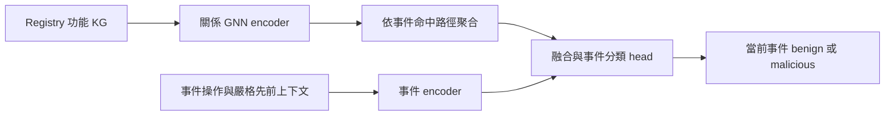

# Registry KG：2025–2026 資安日誌標註與圖學習文獻對照

檢索日期：2026-10-29。範圍包含 2025 年起、截至本日可查的正式論文與預印本。這是針對本專案的文獻盤點，非窮盡式 systematic review；沒有查到相同方法不代表已證明首創。方法、缺口及實作建議分開記錄；未執行外部專案或重現其分數。

本次查核以會議／期刊、作者論文、研究機構與作者 repository 為依據。搜尋涵蓋 audit log labeling、provenance ground truth、Windows Registry semantics、LLM investigation、GNN intrusion detection、graph-language learning；排除僅以 AIOps 故障異常代替資安惡意標籤的工作作主要證據。比較對象的標籤單位可能是事件、實體、子圖或情境，不能直接比較論文 F1 數字。

## 1. 對照本專案的基礎

本次重新讀取 snapshot：197 節點、192 條 `HAS_CHILD`、46 條獨立語意邊。145 個 documented、52 個 structural；包含 scope、cannot_infer、來源與受限模板。這是共用的 Registry 功能知識，不是事件溯源圖，也沒有每個 key 固定的惡意標籤。節點說明由 agent 研究與審查，不宜在論文中描述成已完成獨立專家標註。

資料盤點沿用 [實驗計畫](REGISTRY_EXPERIMENT_PLAN.md)：11 份錄製，2,892,462 筆 Registry 事件、728 筆人工 positive，其中 CHT 690、APT 38。大量事件相依與重複，不能當作數百萬個獨立訓練案例。timestamp 只用於順序；CHT 缺少 Value data；保留來源群組隔離及已發現的標籤洩漏排除規則。

## 2. 細粒度標註、語意與調查

### P01 — AutoLabel（USENIX Security 2025）

**AutoLabel: Automated Fine-Grained Log Labeling for Cyber Attack Dataset Generation**，Peng et al.。[會議／論文](https://www.usenix.org/conference/usenixsecurity25/presentation/peng-yihao)、[官方實作](https://github.com/autolabel-open/autolabel)。

- 已做：在受控攻擊實驗中加入輔助追蹤資訊，關聯 audit/application/traffic logs，提取攻擊子圖，再映射到細粒度 log 標籤。
- 查核位置：論文 §2.3、§3.1。假設 Linux server、可插入 instrumentation，以及額外的對齊／攻擊資訊。
- 本專案切入點：既有 Windows 錄製無法事後補出這些觀測，可研究功能 KG 支援的候選標註與證據審核。
- 界線：KG 無法替代 attack ground truth 或恢復不存在的因果訊號；不能把模型預測直接當新 ground truth。其特定實驗的標註準確率不適用於本資料。

### P02 — What We Talk About When We Talk About Logs（IEEE S&P 2025）

**What We Talk About When We Talk About Logs: Understanding the Effects of Dataset Quality on Endpoint Threat Detection Research**，Liu et al.。[作者機構論文頁](https://experts.illinois.edu/en/publications/what-we-talk-about-when-we-talk-about-logs-understanding-the-effe/)、[作者 PDF](https://www.jdliu2.web.illinois.edu/papers/sp25-wwtawwtal.pdf)。

- 已做：分析背景活動的合成性與攻擊顯著性，指出它們分別可能膨脹 TNR 與 TPR。
- 本專案切入點：檢驗 KG 的改善是否仍存在於去除名稱捷徑、按錄製依賴群組切分之後。
- 界線：balanced accuracy 可處理類別權重，但不能修正背景過於簡單、資料重複或 train/test 洩漏。不能把「使用 macro 指標」本身當研究創新。
- 閱讀程度：機構摘要與書目已核對；作者 PDF 網頁工具因檔案大小無法完整讀取，不聲稱逐節審讀。

### P03 — Windows EDR provenance（PRISM 2026，NDSS workshop）

**How to Effectively Trace Provenance on Windows Endpoint Detection & Response Telemetry**，Liu et al.。[正式論文](https://www.ndss-symposium.org/wp-content/uploads/prism2026-12.pdf)、[會議頁](https://www.ndss-symposium.org/ndss-paper/auto-draft-660/)。

- 已做：針對 Windows IPC、Registry 與資料存取造成的圖膨脹，設計控制流程與資料實體處理 heuristics；在 CARBANAKv2 評估。
- 關鍵位置：§V-A 的路徑 masking／clustering；§V-A、Fig. 5 討論 Doc2Vec 的 parent-child 編碼不足；§V-B 的 leaf pruning；§VII 討論領域知識。
- **最直接缺口**：測試 Registry 完整前綴、階層及功能關係，能否比字串／Doc2Vec 更好保留路徑上下文；在壓縮時保留與設定變更有關的證據。
- 界線：Fig. 5 的具體探針使用資料路徑／檔案路徑，將其推展至本 Registry KG 是本研究假設。不能將圖縮減率當偵測準確率，也不能宣稱論文已證明 pruning 漏掉 Registry 攻擊。
- 作者在文末提供 [REAPr 程式](https://bitbucket.org/sts-lab/reapr-ground-truth) 與 [CARBANAKv2](https://bitbucket.org/sts-lab/carbanakv2/)；本次核對論文中的發布宣告，未下載執行。

### P04 — OntoLogX（2025 預印本；Advanced Intelligent Systems 2026）

**OntoLogX: Ontology-Guided Knowledge Graph Extraction from Cybersecurity Logs with Large Language Models**，Cotti et al.。[論文全文](https://arxiv.org/html/2510.01409)、[正式發表紀錄](https://orca.cardiff.ac.uk/id/eprint/186655/)、[官方實作](https://github.com/LucaCtt/ontologx)。DOI：10.1002/aisy.202501381。

- 已做：ontology、RAG、驗證／修正迴圈，將 logs 轉成事件 KG，再作 session 級 ATT&CK tactic 預測。
- 本專案差異：外部共用 Registry 功能 KG 可作查詢來源，限制模型把 path 名稱直接解讀成攻擊意圖。
- 待驗證缺口：逐事件分類下，scope／cannot_infer／來源是否改善誤報與證據支持率。
- 界線：不能宣稱此前無 ontology-guided log KG 或 KG＋LLM；本研究要控制相同事件、功能文字及輸入預算。

### P05 — SmartGuard（2025 預印本；2026 修訂，正式 venue 未確認）

**SmartGuard: Leveraging Large Language Models for Network Attack Detection through Audit Log Analysis and Summarization**，Zhang et al.。[論文紀錄](https://arxiv.org/abs/2506.16981)、[全文 §3.2／Appendix B](https://arxiv.org/html/2506.16981)。

- 已做：由 audit logs 建 KG，聚合 thread 層級行為；GAT 編碼與文字摘要配合 LLM 判斷。
- 關係：這是「語意＋圖 embedding＋LLM」最直接的近鄰之一，不能忽略。
- 本專案可測差異：文件支持、獨立於事件的 Registry 功能知識；完整路徑與模板區別；當前事件標籤；scope 和推論限制的消融。
- 實作狀態：已讀模型描述及 loss 設計；本次未找到可確認屬於作者的公開完整程式。方法參考與可直接重現的 baseline 要分開。

### P06 — AuditBench（2026 預印本，正式 venue 未確認）

**Benchmarking and Exploring the Capabilities of LLMs for Attack Investigations**，Anand et al.。[論文](https://arxiv.org/abs/2606.10281)、[全文](https://arxiv.org/html/2606.10281v2)、[官方資料與評分實作](https://github.com/aanand300/auditlogsbench)。

- 已做：Linux／Windows、51 個情境、四種調查任務；對比 raw／edge 表達並分析誤報。
- 關鍵位置：§5、§6.3。模型常過度懷疑，錯誤理由常依賴物件名稱與事件順序；§5.4 顯示額外 domain context 的效果因模型而異。
- 本專案切入點：固定小模型下，以可追溯功能知識降低名稱捷徑及無證據推論。
- 界線：其情境／實體評分和本專案逐事件人工標籤不同；其「較小模型」亦不等於本專案的 3B–8B SLM。不能直接挪用分數比較。

## 3. 可參考實作的圖模型

### P07 — ORTHRUS（USENIX Security 2025）

**ORTHRUS: Achieving High Quality of Attribution in Provenance-based Intrusion Detection Systems**，Jiang et al.。[論文](https://www.usenix.org/conference/usenixsecurity25/presentation/jiang-baoxiang)、[官方程式與權重說明](https://github.com/ubc-provenance/orthrus)。

使用時空 GNN 與依賴分析處理偵測、歸因及人工調查負擔。適合參考動態事件圖、節點評分與 attribution 評估。其節點級目標不能直接替代本事件級標籤；其真實時間設計需要改成符合本資料順序契約的版本。

### P08 — Sometimes Simpler is Better（USENIX Security 2025）

**Sometimes Simpler is Better: A Comprehensive Analysis of State-of-the-Art Provenance-Based Intrusion Detection Systems**，Bilot et al.。[論文](https://www.usenix.org/conference/usenixsecurity25/presentation/bilot)、[artifact appendix](https://secartifacts.github.io/usenixsec2025/appendix-files/sec25cycle2ae-final26.pdf)、[論文版程式分支](https://github.com/ubc-provenance/PIDSMaker/tree/velox)。

統一比較八個 PIDS，指出多項實務與評估問題；簡單神經模型在多個測試集已具競爭力。對本研究的要求是：必須設 MLP／無 message passing baseline、報多 seed 波動與成本，不能預設越深越好。論文 artifact 與持續更新的 main 分支應分別鎖定。

### P09 — OCR-APT（ACM CCS 2025）

**OCR-APT: Reconstructing APT Stories from Audit Logs using Subgraph Anomaly Detection and LLMs**，Aly et al.。[論文及發表狀態](https://arxiv.org/abs/2510.15188)、[官方程式](https://github.com/CoDS-GCS/OCR-APT)。

結合 one-class 關係圖模型、異常子圖與 LLM 調查報告。已實際讀取作者程式：

- [OCRGCNBase](https://github.com/CoDS-GCS/OCR-APT/blob/main/src/pygod/nn/ocrgcn.py)：`forward(x, edge_index, edge_type)`、RGCN 層、可設定深度；預設 2 層。
- [OCRGCN detector](https://github.com/CoDS-GCS/OCR-APT/blob/main/src/pygod/detector/ocrgcn.py)：embedding 與中心距離的一類異常偵測。
- [訓練入口](https://github.com/CoDS-GCS/OCR-APT/blob/main/src/train_gnn_models.py)：使用 PyG 資料與專案內修改的 PyGOD。

**最接近可借用的多關係 GNN 實作**。需要重定義 Registry 關係、加入事件級 head；原本學的是事件 provenance，不是靜態功能 KG。其完整系統依賴 RDF／GraphDB；只借模型模組時不必先移植整套基礎設施。未在本機驗證執行成功。

### P10 — PIDSMaker（2026 框架論文；承接 2025 artifact）

**PIDSMaker: Building and Evaluating Provenance-based Intrusion Detection Systems**，Bilot, Jiang, Pasquier。[論文](https://arxiv.org/abs/2601.22983)、[作者 repository](https://github.com/ubc-provenance/PIDSMaker/)。arXiv 頁提供預印本；作者 repository 標示 KDD 2026，精確 proceedings 書目尚未另行核對。

統一 preprocessing、feature encoder、GNN、decoder 與評估，支援消融和多次執行。最適合當後續整體 benchmark 底座：將 KG 表示做成可替換的 featurization，保持其餘模型不變。自訂 CHT／APT ingest、事件級 scorer 及順序契約仍需實作，不能直接拿預設 dataset split。

### P11 — APT-CGLP（2025 預印本；KDD 2026）

**APT-CGLP: Advanced Persistent Threat Hunting via Contrastive Graph-Language Pre-Training**，Qiu et al.。[論文與正式書目](https://arxiv.org/html/2511.20290v2)。DOI：10.1145/3770854.3780275。

以 contrastive graph-language pretraining 對齊 provenance 子圖與 CTI，屬於圖／文字跨模態方向。可參考對齊目標，將本 KG 子圖與有來源功能說明配對；但197節點不等於足夠的大型預訓練語料，且同一說明產生的改寫不能當獨立測試。本次未確認作者公開完整程式，不列為第一個可執行 baseline。

### P12 — PROVEX（2025 預印本，正式 venue 未確認）

**PROVEX: Enhancing SOC Analyst Trust with Explainable Provenance-Based IDS**，Dhanuka and Rastogi。[論文](https://arxiv.org/abs/2512.18199)、[官方實作](https://github.com/devang1304/provex)。

在 KAIROS 上適配 GraphMask、GNNExplainer 等解釋方法，適合作為 GNN 解釋與展示的參考。可用本 KG 為重要節點補上功能說明，但 attribution／attention 不能證明因果；忠實解釋一個模型也不代表模型判斷正確。

另行追蹤：[ProvPlug 作者程式](https://github.com/xu-zhiwei/ProvPlug) 宣告結合 LLM 與 provenance 領域知識的 plugin 框架。已確認 repository，尚未完成正式出版 metadata 與全文交叉核對，不以搜尋摘要中的 venue/year 作確定引用。

## 4. 建議研究缺口：依據與驗證分開

| 候選缺口 | 文獻依據 | 本 KG 提供什麼 | 必須新增的實驗 |
|---|---|---|---|
| 路徑表示是否保留階層與功能上下文 | P03 §V-A/Fig.5 | 完整 canonical prefix、父子與語意關係、模板界線 | 字串／Doc2Vec／文字 encoder／ancestor pooling／GNN 對照；跨名稱與錄製測試 |
| 模型把名稱與功能誤當成惡意證據 | P06 的誤報分析；P04、P05 已有語意方法 | scope、cannot_infer、來源與未知狀態 | 同資訊量比較；移除限制、移除來源、移除結構的消融；人工檢查主張支持 |
| Windows 圖壓縮與事件證據保留的取捨 | P03 clustering/pruning | 可還原的功能分組與原事件映射 | 壓縮率對攻擊事件保留率、FPR/recall、成本曲線；不能只報縮圖率 |
| 既有錄製的候選標註與審核成本 | P01 的受控輔助資訊前提 | 無需重錄即可查功能、提出引用支持的候選 | 凍結人工真值；盲化人工審核、修正率、耗時、一致性；不以模型生成答案評自己 |

這些是**有文獻依據的研究假設**，目前尚未證明改善。KG 不足以補足未記錄的 value data、操作結果、授權狀態或真實因果流；需要如實保留不確定性。

優先題目建議：**Evidence-grounded Registry Semantics for Fine-grained Audit Log Labeling**。如果圖結構消融有明顯、穩定增益，再擴展為 **Hierarchy-aware Registry Representations for Cross-recording Security Event Classification**。只在目前11份資料有結果時，不聲稱跨企業或新 APT 家族泛化。

## 5. GNN 應如何接到目前 KG

### 5.1 任務與圖的分工

固定功能圖 `G_K` 保存本來的197節點，事件仍存在獨立資料集／暫態樣本圖 `G_E`。每個事件建立唯讀 `event → matched knowledge IDs` 對應。概念父子邊、文件語意邊與實際事件關係不能混成同一種因果邊。

每個事件輸出：`p(y_e | observed_event, prior_context, retrieved_KG)`。不能訓練「Run key = malicious」的知識節點分類；同一 key 可出現在合法與惡意事件。

### 5.2 最小模型

1. 從現有 `artifacts/model-data/graph/{snapshot.json,node-index.json,edge-index.json,semantic-edges.jsonl}` 讀取資料；確認父子邊與語意邊均被納入，不把欄位名當作已包含全部邊的保證。
2. 節點輸入：凍結的功能文字 embedding、depth、hive、documented/structural、placeholder 等。來源狀態作明示特徵，不能憑空當已校準的可信機率。
3. 使用 2 層 R-GCN、64／128 維作開發候選；父子及不同語意關係保留 edge type。反向邊只作 message passing，明示為計算用邊，不新增文件支持的主張。[PyG RGCNConv 官方介面](https://pytorch-geometric.readthedocs.io/en/latest/generated/torch_geometric.nn.conv.RGCNConv.html)
4. 對事件命中的整條 ancestor path 做 pooling，另附 terminal exact/template/unknown 狀態。未知子路徑保留未知特徵，不能直接借用祖先功能作確定結論。
5. 與 relation、actor、可用 value 結構及 K=0／16 歷史表示融合，由小型 MLP 輸出事件類別。初版與 SLM 方法分開比較，避免同時引入太多變因。
6. 若接 SLM，先使用 GNN 排序後的節點 ID 取回原文證據；直接把數值 embedding 印進 prompt 不保證模型能解碼。可訓練 projector 是另一個需要資料和消融的研究。

197個節點並非不能訓練 GNN，但僅有單一小型知識圖，不能把節點數當攻擊樣本數。先驗證淺層網路的增益，深度 1／2／4／8 僅作消融，檢查泛化、表示相似化及穩定性。2層 GNN 配合全路徑 pooling 不需要用9層傳播才能取得所有祖先的資訊。

### 5.3 訓練與公平比較

- 第一輪 GNN 可用凍結文字特徵＋小型監督 head／encoder，但必須先指定開發、驗證、測試群組。原本固定 SLM 的「零樣本配對評估」不能直接變成全資料監督訓練。APT positive 稀少，不預設僅靠 APT 就能訓練穩定模型。
- 可另研究 benign-only event encoder 或 KG 自監督，但 anomaly score 不等於惡意機率。KG 已知邊重建成功只證明表示能力，不證明 attack detection。
- 外部凍結 KG 可以跨 split 共用；test 事件的屬性、標籤與未來活動不能藉共享節點反向傳入訓練。初版單向讀取 KG，避免共享節點吸收所有錄製事件。
- 若評估 link prediction，held-out 邊及其反向邊不能留在 message-passing graph；亦須稽核文字及祖先鏈是否直接洩漏答案。KG 缺邊不是已確認的負面功能主張。
- 自監督的改寫／遮罩 view 不是獨立事件。文獻自己的資料切分與門檻不可盲目套用。

必要 baseline：事件特徵 MLP；＋相同節點文字 pooling；＋無 message passing 的 ancestor pooling；＋階層 GNN；＋階層與語意邊 GNN。後兩者比較才衡量46條語意邊的價值。另用固定的 typed-edge 置亂控制、純拓譜／文字＋拓譜消融與多個 seed，排除參數量或 path identity 記憶效果。

主要報 balanced accuracy、macro-F1、惡意 recall、FPR、逐錄製 support；有未判定時沿用 [agent 規格](SLM_AGENT_FRAMEWORK_PLAN.md) 的分母規則。自然比例／抽樣權重、重複事件群組及 benign-only 錄製必須透明。額外報 KG coverage、同名異路徑錯誤、模板／未知分層、表示探針、訓練與推論成本。不能拿文獻 scenario/node 指標直接對照本 event 指標。

## 6. 實作順序與可交付物

| 優先序 | 工作 | 產物與完成判準 |
|---|---|---|
| 1 | 完成 Registry 適配與 KG 命中稽核 | `event_knowledge_links.jsonl`、coverage、未知隔離與來源映射 |
| 2 | 固定 SLM 的 raw／文字／結構／限制欄位消融 | 同目標 predictions、BA/FPR、引用及主張支持審核 |
| 3 | 文字 pooling／ancestor pooling／2層 R-GCN | tensor manifest、model config、按群組切分、各 seed 結果 |
| 4 | 以 OCR-APT 模組或 PIDSMaker 整合 | 自訂 adapter 與 event scorer；與同底座無 KG 比較 |
| 5 | 人工輔助標註或圖壓縮研究 | 盲化審核成本，或壓縮率對證據保留率曲線 |

建議先讀 P03、P06、P05 判定差異，再讀 P09 的模型程式與 P08/P10 的評估框架。P01 用來釐清「建立真值」與「預測候選標籤」，P02 用來檢查資料是否讓問題過於容易。

本次僅新增文獻盤點與連結。沒有改動 KG、資料標籤、模型環境或執行任何訓練；公開 repository 已存在不代表本機可直接重現，後續需鎖定 commit／依賴／資料版本再做 smoke test。
