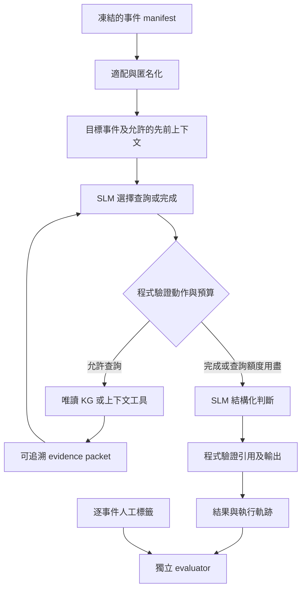

# SLM Registry 調查 Agent：框架與實驗規格

日期：2026-10-26。狀態：規劃，尚未實作 agent、安裝推論服務或執行模型實驗。延續 [CHT／Caldera 實驗計畫](REGISTRY_EXPERIMENT_PLAN.md)；設定草案見 [agent protocol](../artifacts/experiment-planning/agent_protocol_draft.json)。

部署補充：使用者後續指定 DGX Spark 僅作模型伺服器，KG／agent／評分由其他內網機器執行。新的 [Spark 部署指引](slm_depoly/README.md) 將主候選提高至 Qwen3.5-27B BF16，並列出32B／122B候選，取代下文早期3B–8B的硬體規模預設；實際model revision仍須部署後凍結。原有資料可見範圍、工具與評估契約維持有效。

## 1. 建議與研究問題

第一版採用「單一 SLM 調查者＋明確狀態機＋唯讀工具」。同一個模型負責選擇查詢與輸出判斷；資料適配、工具授權、預算、引用驗證、評分由程式處理。先完成固定 KG 檢索流程，再加入自主選擇檢索的 agent。多代理辯論、長期記憶、線上知識更新留待有實驗證據支持時再加入。

研究問題分開驗證：

1. **功能知識是否有用？** 正規化事件 B 與固定 KG 流程 D 比較。
2. **自主檢索是否有用？** 固定 D 與 D-agent 比較，限制相同資料可見範圍與資源上限。
3. **改善來自哪些因素？** 同事實重播與等呼叫預算控制，拆分證據選擇、多輪處理與成本差異。
4. **KG 結構表達是否有用？** D 與同事實 D-flat 比較；不能只比較不同內容量的 C/D 就宣稱圖結構有效。

研究貢獻應落在有來源的 Registry 語意、事件證據連結及可驗證的判別增益；使用某個 agent 套件本身不是成效證據。

## 2. 技術選型

建議以 **LangGraph 管理狀態與轉移、本地 SLM 推論介面、既有 KnowledgeBase 作為工具**。LangGraph 區分預定路徑的 workflow 與模型決定工具使用的 agent，支援持久化與除錯；適合用同一套工具實作兩種對照。[官方文件](https://docs.langchain.com/oss/python/langgraph/workflows-agents)

| 層 | 第一版選擇 | 理由與界線 |
|---|---|---|
| 調度 | LangGraph 明確節點與條件邊 | 每一步可記錄、恢復、限制；不依賴預設無限工具循環 |
| 模型 | 一個固定 revision 的 3B–8B instruction SLM | 型號、量化與 batch 在硬體測試後凍結；第一輪不微調 |
| 推論 | 本地 vLLM；經 `ModelAdapter` 隔離 | 使用 JSON schema 約束動作與答案；實作前確認所選模型、硬體與版本相容 |
| 知識 | 直接包裝 `KnowledgeBase.model_context()` | 197 節點先用確定性的路徑查詢；不需要先導入向量庫或圖資料庫 |
| 儲存 | JSONL 軌跡、SQLite 本地 checkpoint／索引 | 完整保存版本與呼叫；不啟用外部 log 上傳 |
| 評分 | 獨立 Python evaluator | 只有 evaluator 可讀取人工答案 |

vLLM 支援 JSON schema structured outputs；原生 tool calling 另外涉及模型 chat template 與 parser 相容性。因此第一版可直接讓 SLM 輸出受約束的 `action` JSON，再由程式執行，不必把原生 function calling 當先決條件。結構合法不代表內容正確。[structured outputs](https://docs.vllm.ai/en/latest/features/structured_outputs/)、[tool calling](https://docs.vllm.ai/en/latest/features/tool_calling/)

smolagents 的 `ToolCallingAgent` 可作輕量替代；其 `CodeAgent` 以程式碼表達動作，超出這個實驗所需的固定查詢能力。第一輪只選一套調度實作，避免把框架比較變成額外研究變因。[官方文件](https://huggingface.co/docs/smolagents/en/index)

依賴放在獨立的實驗環境並鎖定版本，不改變目前核心套件的 Python 3.9+／stdlib 契約。新環境的 Python 版本依選定依賴的實際要求決定。

## 3. 狀態與資料流



`AgentState` 分成控制平面與模型可見部分，不能整個序列化到 prompt。

- 控制平面：run ID、來源映射、版本 hash、可存取 event/node ID 集合、呼叫數、token 用量、checkpoint、失敗狀態。原始錄製識別只由控制平面保管。
- 模型可見：當前事件的匿名代號與正規化事實、允許的先前上下文、工具回覆、已提供證據的本地代號、資料不足事項。
- 每個目標重新建立狀態。跨事件只共用不依賴標籤的 KG 快取，不共享前一目標的判斷或推論記憶。
- 模型只能引用已交付的 evidence ID。模型提出的新事實或關聯視為假說，不回寫 KG。

主比較 K=0 與 K=16 各自獨立。K=16 時固定流程與 agent **起始就收到相同的前 16 筆允許事件**，先只研究知識檢索的選擇。動態取得歷史列為次要實驗，另行控制事件可見範圍。

時間只用於先後參考；允許歷史必須來自同錄製、同程序且 timestamp 嚴格小於目標。同 timestamp 不推定因果順序；列號只提供穩定識別。邊界同序事件可用固定列號作抽樣取捨，但必須標記為無已知內部順序，不把該取捨呈現為真實時間順序。不能衍生秒數視窗或頻率。

## 4. 工具契約

下表是待實作的 wrapper，並非現有公開 API。agent 不能傳任意檔案路徑、SQL、Python 或網址。

| 工具 | 模型提供 | 程式回傳 | 限制 |
|---|---|---|---|
| `lookup_registry` | 已可見的 event IDs，最多 4 個 | 對應 key/value 的前綴知識、功能、scope、限制、來源、命中狀態 | key/value 由適配器取得；模型不能自行改寫出新路徑 |
| `expand_knowledge` | 已回傳的 node IDs，最多 6 個 | 一跳有來源語意邊與相鄰節點的相關主張 | 只查凍結 snapshot；總回覆受 token 上限限制 |
| `get_prior_context` | k，限 0–16 | 同程序、嚴格先於目標的允許事件 | 只在動態上下文次要實驗開啟；無跨錄製與向後看能力 |

操作語意契約由程式固定提供，例如 query/set/delete 的觀測意義、是否缺少 outcome，不交給 SLM 猜測。

`lookup_registry` 包裝目前的 `model_context(raw, value_name, path_format, template_candidates)`。`expand_knowledge` 需新增公開 wrapper，直接讀 snapshot 已存在的邊與主張，避免依賴 `KnowledgeBase` 私有屬性。

保留並逐項呈現 `path_complete`、`explanations_complete`、`pattern_complete`、`pattern_explanations_complete`、`template_bindings`、`unknown_components`。不能把模板匹配、祖先命中或未知子路徑合併成「完全理解」。documented 與 structural 節點的支持範圍亦須區分。

所有工具回覆採固定 schema，附 snapshot hash、查詢來源、evidence IDs 與截斷清單。以完整主張為單位壓縮，保留對應 scope／cannot_infer／來源，不只留下有吸引力的功能句子。截斷排序規則需在開發階段固定，不能依測試標籤調整。

第一輪不提供 ATT&CK、VirusTotal、網路搜尋工具；現有研究問題是功能 KG 的支援效果。後續若加入攻擊知識，另建版本與工具條件，保留來源日期，評估案例與測試樣本重疊。VT 的檔案 verdict 不能當每個 Registry 事件的答案。

## 5. Semantic expression 與輸出

模型輸入的語意表達由固定模板組成，不先使用另一個 SLM 自由改寫：

1. `observed_facts`：relation、程序與目標、已觀測 key/value、先前事件。
2. `registry_function`：命中節點的功能、適用範圍、值語意與來源。
3. `relations`：有來源的知識關係；與實際事件之間的順序／程序關係分開。
4. `limits`：讀取不等於變更、變更不等於成功或執行；缺失欄位、模板依賴、無法推論之處。

例如，某程序讀取 Run key：能連結「該 key 的啟動用途」與「這次觀測是讀取」，但不能僅因 Run 可供持久化就認定這筆事件惡意。若缺少足夠行為證據，可輸出 insufficient_evidence；正常用途與惡意判斷仍須對照該事件本身。

動作使用 discriminated union：`retrieve(calls)` 或 `finalize`。最多每輪兩個查詢；同輪呼叫不可依賴另一個呼叫尚未返回的 ID。最終判斷 schema 草案：

```json
{
  "prediction": "benign | malicious | insufficient_evidence",
  "evidence_event_ids": [],
  "knowledge_node_ids": [],
  "claims": [
    {"statement": "brief evidence-linked explanation", "evidence_ids": []}
  ],
  "unknowns": [],
  "score": null
}
```

`prediction` 上述字串表示三選一，實際 schema 使用 enum。`score` 第一版固定 null；若後續提供模型分數，須另定義取法及開發集校準。模型自報 confidence 不是已校準惡意機率。

程式能驗證 JSON、ID 存在且已交付、引用對象與必填欄位；**不能只靠 ID 合法就認定自然語言主張被支持**。抽取分層案例由人檢查「事件事實／KG 功能／結論」的支持關係，最好隱藏方法名稱；另記違反 cannot_infer 的案例。不要求輸出內部思考鏈。

## 6. 預算、失敗與資料隔離

以下為 pilot 初始預算，須以合成題及開發資料檢查後凍結，不是已量測的最佳設定：

| 項目 | 草案 |
|---|---:|
| 自主查詢輪數 | 最多 2 |
| 每輪工具數／總工具請求數 | 最多 2／4，重複與被拒請求也計數 |
| 模型呼叫 | 最多 4：兩次查詢決策、一次判斷、一次修復 |
| 每次模型 input／output 上限 | 4,096／512 tokens |
| 每目標所有模型 input＋output 上限 | 18,432 tokens，含重送 prompt、修復與可計量的推理 tokens |
| 知識擴展 | 一跳，單次最多 6 個 seed |
| 歷史範圍 | K=0 或 16；嚴格先前事件 |
| 格式／引用修復 | 最多一次，只用原有證據與錯誤清單 |

可提前結束，查詢額度用完則進判斷。控制器預留判斷所需預算；不得因前兩輪用滿就偷偷增加呼叫。修復只針對格式或引用錯誤，不能因預測不符人工答案而重試。服務超時與重啟留下 attempt 紀錄；如果推論可能已發生但用量未知，標示 unknown_usage，不把成本當零。

最終狀態區分 `valid`、`abstained`、`invalid_output`、`tool_error`、`budget_exhausted`、`inference_error`。工具失敗若仍可依已有證據判斷，保留工具失敗軌跡及有效判斷；無法判斷則記錄終止原因。禁止默認為 benign。

人工 label、ATT&CK 答案、recording/APT 名稱、來源檔名、sample hash、`timestamp_raw` 及其存在性，都不能進 prompt 或工具回覆。CHT 已發現 `timestamp_raw` 與標籤完全對應，需對欄位白名單和工具回覆一併檢查。實驗目錄名稱如 Evil／MaliciousFiles 依既有規範匿名化。

event ID 對模型使用當次匿名代號；實際來源映射保留在 evaluator 一側。Registry value、cmdline 等文字以不可信資料欄位傳遞，不能因含有指令文字就擴權或改變工具 schema。以含偽指令的合成事件驗證此界線。

主跨域輸入維持共同欄位；CHT 沒有 Value data，不能讓 agent 從別的工具繞過此限制。APT Value data 僅在明示的次要條件開啟。

## 7. 對照設計與指標

| 條件 | 查詢／判斷方式 | 可回答的問題 |
|---|---|---|
| B | 正規化事件，無 KG，一次判斷 | 無知識基準 |
| D-fixed | 固定選擇 KG 證據，一次判斷 | 固定 KG 表達的效益 |
| D-agent | SLM 在相同可存取證據集合內選擇工具 | 完整自主檢索方法的品質與成本 |
| D-replay | 將 D-agent 最終實際取得的證據，按固定格式交給一次判斷 | 在相同取得事實下，多輪流程是否仍有差異 |
| D-budget | 固定檢索與固定檢查步驟，使用相同呼叫／token 上限 | 排除只因 agent 有更多推論機會而改善 |
| D-flat | 與 D-fixed 完全相同事實，移除階層與關係標示 | 結構表達的作用 |

同證據集合不代表實際取得證據相同；D-agent/D-fixed 差異不能單獨歸因於推理能力。D-replay 的證據本身由 agent 選擇，是診斷用控制；其端到端成本須包含取得該證據的 agent 查詢，另列「只算最後分類」的成本，不能當成免費檢索。仍須報告 D-budget 的實際用量，不能把相同上限稱為相同 FLOPs。

先做既有 A/B/C/D 的固定流程，再做 D-agent、D-replay、D-budget。K=0 和 K=16 分開報；第一輪自主工具只改變 KG 取得。動態歷史檢索、攻擊案例庫、第二個 SLM、微調依序作後續消融。

所有條件使用相同 target manifest、模型 revision、tokenizer、量化、模板版本、工具 snapshot、截斷規則、輸出 schema、修復政策與允許證據範圍。凍結 seed 並記錄推論服務的可重現限制。選取完整資源上限下的品質／成本曲線，避免只挑對 agent 有利的預算點。

主指標維持兩類 recall 的 macro average。含拒答時明確寫成：

`BA_all = 0.5 × (正確判為惡意數 / 全部真惡意數 + 正確判為良性數 / 全部真良性數)`

拒答、解析失敗、未完成目標留在各自真實類別分母。這是將未判定視為失敗的 balanced class recall；無拒答時等於標準 binary balanced accuracy。另報 coverage、已判定子集 BA、2×3 混淆表（benign／malicious／未判定）、macro-F1、惡意 precision/recall、FPR。macro-F1 計算時未判定不算任一類 TP，但計入真實類別 FN；未判定也不能偷偷算作 TN。只有單一真實類別的錄製 BA=N/A。

agent 額外指標：工具合法率、工具失敗率、重複查詢率、引用合法率、人工證據支持率、超預算／拒答率、總 input/output tokens、真實推論 p50/p95 延遲。合法引用率與主張支持率分開。按 exact/template/ancestor/unknown 分層檢查失敗，不排除未知路徑。

沿用既有依賴群組、抽樣權重及 paired 分析。APT 的 Registry positive 只有 38 筆，CHT 為 690 筆；raw 事件數不代表獨立案例數。禁止隨機逐列切分；CobaltGroup／Higaisa／Gamaredon 至少視為同一依賴群組。評分後修改提示或 KG 的版本，不再沿用原來的盲測宣稱。

## 8. 實作順序、產物與驗收

以下模組皆為預計新增：`experiments/registry/agent/{state,tools,policy,graph,model_adapter,validation,trace}.py`。重用實驗計畫的 ingest、normalize、context、split、semantic、runner、metrics，不另外複製資料適配邏輯。

| 階段 | 工作 | 產物 | 驗收 |
|---|---|---|---|
| F0 | 完成前計畫 P0–P3，凍結事件契約與證據範圍 | 資料 manifest、KG coverage、sanitized packets | 無答案欄位、無未來事件，key/value 可追溯 |
| F1 | 實作狀態、工具 wrapper、固定 D | tool schemas、固定檢索 runner、fixture traces | 不呼叫 SLM 也能驗證工具與重播 |
| F2 | 接本地 SLM、action JSON、受限循環 | model config、agent runner、checkpoints | 每目標有限終止；引用與預算檢查通過 |
| F3 | 用合成／開發目標作約 200 筆工程 pilot | 工具成功率、輸出合法率、成本報告 | 先排除框架錯誤，再凍結設定；不以測試答案修 prompt |
| F4 | 執行配對消融與獨立評分 | predictions、metrics、paired deltas、error cases | 同目標清單、分母守恆、未知／失敗不被刪除 |
| F5 | 教授討論用案例呈現 | 本地 HTML 或 Markdown 案例頁 | 同時展示成功、漏報、誤報、拒答與成本 |

每次 run 儲存 `config.json`、`tool_schema.json`、`prompts.jsonl`、`tool_calls.jsonl`、`evidence_packets.jsonl`、`predictions.jsonl`、`usage.jsonl`、`metrics.json`。資料與知識來源、model/tokenizer、依賴 lock、程式及設定 hash 必須可定位；當前 checkout 沒有 Git metadata 時以來源檔 manifest hash 代替 commit。run 完成後才由 evaluator 關聯 label。

恢復執行以 `(run_config_hash, target_id)` 對應 checkpoint；已完成目標不重複計入結果。尚未完成的呼叫若無法確認結果，可重跑但保存所有 attempts 與不確定成本。知識工具可離線重播；模型輸出不承諾跨硬體 bitwise 一致。

必要測試：洩漏欄位／偽指令 fixture、同 timestamp 不算先前、跨錄製查詢拒絕、未知與模板路徑、scope/限制保留、非法工具與 ID、重複呼叫耗盡預算、無效輸出修復上限、checkpoint 恢復、同證據 replay、單類／拒答／加權評分。這些測試檢查研究契約；不能以通過單元測試取代真實判別成效。

最先可交付的成果是 **F1 的三個唯讀工具契約、可重播的固定 KG 流程與證據封包**。接著 F2 才開啟 SLM 自主選擇工具。若 agent 未在品質或成本上優於固定流程，仍保留固定流程作研究結論與實際入口。
