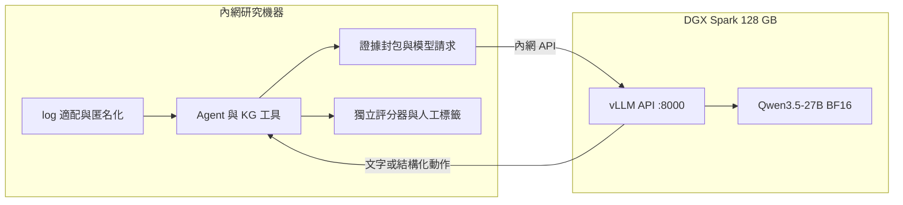

# DGX Spark 專用模型伺服器：選型與逐步部署

更新：2026-10-26。資料夾名稱依使用者指定保留為 `slm_depoly`。

**架構：DGX Spark 只載入模型並提供內網 HTTP API；KG、agent、log 適配與評分全在其他內網機器。** Spark 不需要本專案完整資料、不需要 LangGraph，也不執行 Registry 查詢工具。

依此分工，模型選型不限於小參數 SLM：27B BF16 是第一個部署驗收點，122B MoE NVFP4 是優先評估的能力升級候選。先以單一推論序列服務多台 client 的佇列請求，可把記憶體優先留給模型；通過驗收後再增加並行數。詳見 [專用推論伺服器的選型決策](MODEL_SELECTION.md#專用推論伺服器的選型決策)。

**主推薦：`Qwen/Qwen3.5-27B`，BF16、文字輸入、第一輪關閉 thinking。** 使用 128 GB DGX Spark，先以 8K context／最多兩個同時執行的序列驗證。`Qwen/Qwen3-32B` BF16 是另一個純文字對照／相容性備案；追求更大容量時再驗證 122B MoE 的 NVFP4 版本。這已超出原先 3B–8B 的研究預設，應明確記錄為新的模型條件。選型理由、記憶體估算與其他候選見 [模型選擇](MODEL_SELECTION.md)。

本目錄提供部署指令、啟動腳本與 API 合成測試；**尚未在你的 DGX Spark 實機安裝、啟動或量測吞吐，也沒有模型判別成績**。指令使用已查閱的官方介面；容器／模型／GB10 的完整組合仍以以下實機驗收為準。



## 讀取順序

1. 本文件：在 Spark 準備、下載、啟動服務。
2. [CLIENT_AND_EXPERIMENT.md](CLIENT_AND_EXPERIMENT.md)：從內網機器測試與接入 agent。
3. [OPERATIONS.md](OPERATIONS.md)：驗收、效能調整、重啟、故障排除與版本凍結。
4. [MODEL_SELECTION.md](MODEL_SELECTION.md)：27B／32B／122B 的取捨。

## 步驟 0：分清楚兩端與路徑

下文 `[Spark]` 在伺服器執行，`[Client]` 在研究機器執行。範例網段必須換成實際環境：

| 項目 | 範例 |
|---|---|
| Spark IP | `192.168.50.10` |
| 允許使用的研究機器 | `192.168.50.20` |
| 模型 API | `http://192.168.50.10:8000/v1` |
| Spark 上的指引／腳本 | `$HOME/slm_depoly` |
| Spark 上的部署狀態 | `$HOME/ants-slm/qwen35-27b-bf16-v1` |
| 對外模型別名 | `registry-slm` |

Spark 上只需要本目錄。從已取得本專案的研究機器複製：

```bash
# [Client] 在 Ants-KG 根目錄；換掉帳號與 IP
scp -r docs/slm_depoly spark-user@192.168.50.10:~/slm_depoly
```

所有後續 Spark 指令可在一般使用者帳號執行；只有既有 Docker／防火牆管理可能需要管理員。模型與執行產物放在獨立目錄，不放入 Git 或覆蓋 KG。

## 步驟 1：確認 Spark 硬體與系統

```bash
# [Spark]
uname -m
cat /etc/os-release
nvidia-smi
free -h
df -h "$HOME"
docker version
docker info
```

預期 CPU 架構是 `aarch64`，GPU 可由 NVIDIA driver 識別。官方硬體指南的 DGX Spark 為 Grace Blackwell、20 核 Arm、128 GB 統一記憶體；請以自己的 `free -h` 確認實際配置。GB 與 GiB 顯示不同是正常現象。[NVIDIA 硬體指南](https://docs.nvidia.com/dgx/dgx-spark/hardware.html)

本主線需要 **128 GB 配置**。CPU／GPU 共享記憶體，不能當作 128 GB 專用 VRAM 再額外加一份 RAM。`nvidia-smi` 某些 memory 欄位若不可用，併看系統記憶體與推論引擎的分配紀錄。建議單模型初次部署預留至少 150 GB 磁碟空間作權重、容器、下載暫存與紀錄；這是工作空間預算，不是模型大小實測。

如果 Docker 或 GPU 容器不可用，先依 [Spark Container Runtime 指南](https://docs.nvidia.com/dgx/dgx-spark/nvidia-container-runtime-for-docker.html) 修復原廠環境。不要為了符合網路上的 x86 教學重裝一套不明版本 CUDA／driver。版本更新依 [Spark 更新指南](https://docs.nvidia.com/dgx/dgx-spark/os-and-component-update.html) 與管理員既有維運方式執行。

## 步驟 2：建立獨立目錄與下載工具環境

```bash
# [Spark] 每次新開 shell 都重新設定這三個變數
export SLM_GUIDE="$HOME/slm_depoly"
export SLM_STATE="$HOME/ants-slm/qwen35-27b-bf16-v1"
export SPARK_BIND_IP="192.168.50.10"

mkdir -p "$SLM_STATE/metadata" "$SLM_STATE/probes"
python3 -m venv "$SLM_STATE/tools-venv"
"$SLM_STATE/tools-venv/bin/python" -m pip install huggingface_hub jsonschema
"$SLM_STATE/tools-venv/bin/python" -m pip freeze > "$SLM_STATE/metadata/tools.requirements.lock.txt"
uname -a > "$SLM_STATE/metadata/uname.txt"
nvidia-smi -q > "$SLM_STATE/metadata/nvidia-smi.txt"
free -b > "$SLM_STATE/metadata/memory.txt"
```

此 venv 只作下載與驗證，不在 host 安裝 PyTorch/vLLM。首次 bootstrap 解析到的套件版本由 lock 保存；再次重現時使用 `pip install -r tools.requirements.lock.txt`。若 `venv` 缺少系統支援，依該台 DGX OS 的套件管理方式安裝對應 Python venv 套件後重試。

## 步驟 3：取得 Arm64 容器並鎖定 digest

主線先使用 `vllm/vllm-openai:v0.28.0`。此 tag 出現在 NVIDIA 現行 Spark vLLM playbook；該官方範例使用另一個量化模型，不等同於已驗證本文件的 27B BF16 組合。[NVIDIA playbook](https://build.nvidia.com/spark/vllm/intermediate)

```bash
# [Spark]
export SLM_IMAGE_TAG="vllm/vllm-openai:v0.28.0"
docker pull --platform linux/arm64 "$SLM_IMAGE_TAG"
docker image inspect "$SLM_IMAGE_TAG" --format '{{.Architecture}}'
docker image inspect "$SLM_IMAGE_TAG" --format '{{index .RepoDigests 0}}' > "$SLM_STATE/image.digest"
export SLM_IMAGE_DIGEST="$(cat "$SLM_STATE/image.digest")"
docker image inspect "$SLM_IMAGE_DIGEST" > "$SLM_STATE/metadata/image-inspect.json"
```

Architecture 必須是 `arm64`。後續使用 digest，不用 `latest`，也不要用 `--platform linux/amd64` 模擬 GPU serving。官方 vLLM 提供 Arm64 容器／建置說明；容器 CUDA 與 host driver 仍須相容。[vLLM 安裝文件](https://docs.vllm.ai/en/latest/getting_started/installation/gpu/)

先測試容器看到 GPU，以及 BF16 基本運算：

```bash
# [Spark]
docker run --rm --platform linux/arm64 --gpus all --network none \
  --entrypoint python "$SLM_IMAGE_DIGEST" -c \
  'import torch; print(torch.__version__, torch.version.cuda); assert torch.cuda.is_available(); print(torch.cuda.get_device_name(0), torch.cuda.get_device_capability(0)); x=torch.randn((256,256),device="cuda",dtype=torch.bfloat16); print((x@x).float().sum().item())'

docker run --rm --platform linux/arm64 --entrypoint python "$SLM_IMAGE_DIGEST" \
  -m pip freeze > "$SLM_STATE/metadata/container.requirements.lock.txt"
docker run --rm --platform linux/arm64 --entrypoint vllm "$SLM_IMAGE_DIGEST" \
  serve --help > "$SLM_STATE/metadata/vllm-serve-help.txt"
```

此測試通過只代表基本 CUDA 運算可用；attention／DeltaNet kernels 仍在模型啟動及請求測試時驗證。若失敗，先修復容器／driver 相容性，不進行模型測試。

## 步驟 4：下載固定版本的模型

```bash
# [Spark]
"$SLM_STATE/tools-venv/bin/python" "$SLM_GUIDE/scripts/download_model.py" \
  --repo Qwen/Qwen3.5-27B \
  --dest "$SLM_STATE/weights"
```

腳本先解析當下 `main` 的完整 commit SHA，寫入 `download-request.json`，再以該 SHA 下載。下載完成逐檔計算 SHA-256，產生 `model.lock.json`。中斷後以相同指令重跑會沿用已鎖定 revision；換模型或 revision 請用新的目錄。全權重雜湊會額外花費磁碟讀取時間。

```text
weights/
  download-request.json
  model.lock.json
  model/
    config.json
    tokenizer...
    model-*.safetensors
```

若要重現另一台機器的 revision，用 `--revision <完整 commit SHA>`，並建立新目錄。模型卡、授權、tokenizer 和 chat template 一起保存。不要把尚未完成下載的 request 檔誤當完整模型 lock。[HF snapshot 與 revision 下載介面](https://huggingface.co/docs/huggingface_hub/guides/download)

## 步驟 5：準備內網存取與 API key

先為 Spark 配置固定 IP 或 DHCP reservation。確認研究機器能到達該 IP，且管理員的 VLAN／主機防火牆只允許指定研究機器存取 TCP 8000。

本主線使用 Linux host networking，vLLM **直接綁定 Spark 的內網 IP**；不使用 `-p` 的 Docker port publishing。已有 UFW 且正在管理這台主機時，可依實際位址新增允許規則：

```bash
# [Spark] 僅在既有 UFW 已啟用、預設 incoming deny 且無廣泛 allow 規則時適用
sudo ufw status verbose
sudo ufw allow from 192.168.50.20 to 192.168.50.10 port 8000 proto tcp
sudo ufw status numbered
```

若 UFW inactive，這條 allow 不構成隔離；由管理員配置既有 ACL／防火牆，不要遠端直接 `ufw enable` 造成 SSH 中斷。多個 client 逐一允許。綁定內網 IP 也不代表只有內網來源能被路由到它，必須驗證實際 ACL。

產生 API key，避免寫進本專案或指令列歷史：

```bash
# [Spark] 檔案已存在時會停止，避免無聲換 key
python3 - "$SLM_STATE" <<'PY'
import os, secrets, sys
from pathlib import Path
root = Path(sys.argv[1])
paths = [root / 'api.key', root / 'runtime.secrets.env']
if any(p.exists() for p in paths):
    raise SystemExit('Key files already exist; reuse them or perform an explicit rotation')
os.umask(0o077)
key = secrets.token_urlsafe(48)
paths[0].write_text(key + '\n')
paths[1].write_text('VLLM_API_KEY=' + key + '\n')
PY
```

API key 用於 `/v1` 驗證；vLLM 並非所有非 `/v1` 路由都受此 key 保護，因此 ACL 仍是服務存取邊界。HTTP 不加密傳輸；若內網不適合傳明文，依 [維運文件](OPERATIONS.md) 使用 TLS 或 SSH tunnel。[vLLM API key 範圍](https://docs.vllm.ai/en/v0.28.0/cli/serve/#--api-key)

## 步驟 6：啟動 27B BF16 推論服務

```bash
# [Spark] 先查看將執行的命令；不會輸出 key 內容
export SLM_MAX_NUM_SEQS=1
bash "$SLM_GUIDE/scripts/serve.sh" --dry-run
bash "$SLM_GUIDE/scripts/serve.sh"
docker logs --tail 100 -f ants-registry-slm
```

看到 startup complete／API 開始服務後，按 Ctrl-C 離開 logs；背景容器仍繼續執行。首次啟動可能需要載入數十 GB 權重與編譯 kernels；不能因尚未開 port 就立即判定當機，應看日誌是否仍有進展。

| 參數 | 初始設定 | 用意 |
|---|---|---|
| 模型 | 27B 原始 BF16 checkpoint | 先排除低位元量化作為變因 |
| `--language-model-only` | 開啟 | 本研究只接收文字，不需要影像輸入 |
| `--tensor-parallel-size` | 1 | 一台 Spark、一個 GPU |
| `--max-model-len` | 8192 | 是每請求輸入＋輸出的服務容量；不是研究允許輸入量 |
| `--max-num-seqs` | 本步驟設為 1；腳本預設 2 | 先驗收單序列，更多 client 請求排隊；之後才測試兩序列 |
| `--gpu-memory-utilization` | 0.70 | 128 GB 機器的初始配置比例，須看實際引擎分配與系統餘裕 |
| `--enforce-eager` | 開啟 | 初次先驗證 eager 路徑；效能優化後另建設定版本 |
| prefix caching／MTP | 關閉／未啟用 | 初版縮小效能與相容性變因 |
| generation config | `vllm` | request 明確指定 decoding，避免隱含模型預設覆寫 |
| 模型網路下載 | offline flags | 完成下載後只讀本地權重；此設定不是網路隔離機制 |

Qwen3.5 官方提供文字模式、thinking 控制與 vLLM serving 介面；本文件將它調整為單台 Spark 的短 context，並未照抄多 GPU／262K 的示範。[模型卡](https://huggingface.co/Qwen/Qwen3.5-27B)、[vLLM 模型 recipe](https://recipes.vllm.ai/Qwen/Qwen3.5-27B)

`serve.sh` 只適用 BF16，遇到 checkpoint 的量化設定會停止。更大的 NVFP4 模型必須使用對應 recipe，不能只改下載名稱就沿用所有旗標。

## 步驟 7：保存有效部署設定

```bash
# [Spark] 這些輸出不包含 Config.Env，避免把 key 寫入研究報告
docker inspect ants-registry-slm --format '{{json .Config.Cmd}}' > "$SLM_STATE/metadata/server-command.json"
docker inspect ants-registry-slm --format '{{.Image}}' > "$SLM_STATE/metadata/container-image-id.txt"
docker exec ants-registry-slm python -c 'import vllm,torch,transformers; print(vllm.__version__,torch.__version__,transformers.__version__)' > "$SLM_STATE/metadata/runtime-versions.txt"
ss -ltn | rg ':8000'
```

若 `rg` 未安裝，可直接檢查 `ss -ltn` 輸出。預期只在指定 Spark 位址的 8000 listen。把 model lock、image digest、啟動參數、程式版本一起保存；不要直接發布完整 `docker inspect` 的容器 Env。

下一步依 [Client 指引](CLIENT_AND_EXPERIMENT.md) 從另一台機器完成認證、JSON 與工具動作驗收，再接入 KG。只看到 `/health` 正常不代表研究可開始。
